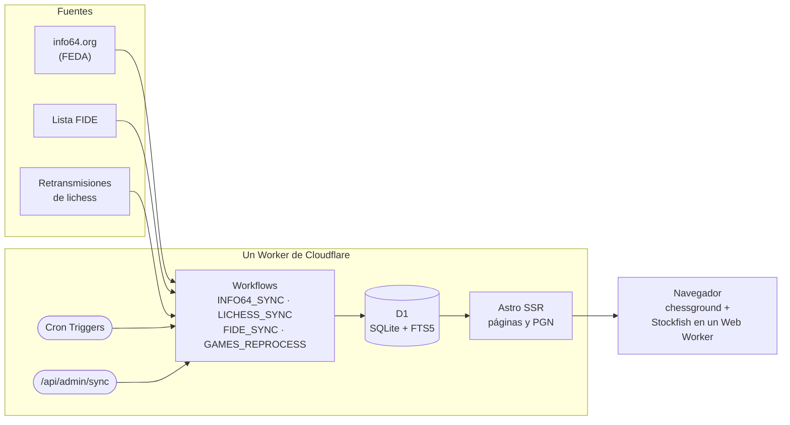

<p align="center">
  
</p>

<h1 align="center">MapleChess</h1>

<p align="center">
  <strong>Prepara tu próxima partida contra un rival de club.</strong><br>
  Los jugadores de la federación española, sus torneos y sus partidas, con visor, Stockfish y PGN.
</p>

<p align="center">
  <a href="https://maplechess.es"><strong>Abrir la web</strong></a> ·
  <a href="https://maplechess.es/acerca">Acerca de</a> ·
  <a href="#cómo-funciona">Cómo funciona</a> ·
  <a href="#licencia">Licencia</a>
</p>

<p align="center">
  <a href="https://github.com/jorgeabf/maplechess/actions/workflows/ci.yml"></a>
  <a href="LICENSE"></a>
  
  
  
</p>

---

Saber contra quién te toca en la próxima ronda, ver qué aperturas juega y dónde se separan de las tuyas, si suele apurarse de tiempo, repasar sus partidas con un motor y descargarlas en PGN. **Sin registro y sin anuncios.**

| | |
| --- | --- |
| **Busca** | Unos 98.000 jugadores españoles de la lista FIDE, más de 12.000 torneos de info64 desde 2014 y sus partidas. |
| **Mira quién te toca** | Los emparejamientos de la próxima ronda, en cuanto info64 los publica, con un enlace para preparar a cada rival. |
| **Prepara al rival** | Un dossier por color: sus líneas principales, qué ha cambiado este año, cómo puntúa según el rival, sus apuros de tiempo y dónde te separas tú. |
| **Analiza** | Visor con variantes, comentarios y relojes, y Stockfish 19 en el propio navegador. |
| **Descarga** | PGN completos, con ELO, FIDE ID, ECO y apertura, de una partida, un torneo, un jugador o una búsqueda. |

## Qué ofrece

### Jugadores

- **Búsqueda por nombre**, con o sin tildes, entre los unos 98.000 jugadores españoles de la lista FIDE. Se puede filtrar por título, ELO y sexo, y quedarse sólo con los activos o con los que tienen partidas.
- Antes de buscar, el **ranking de España** a ritmo estándar, en absoluto, femenino, sub-18, +50 y +65 (por año de nacimiento, como la FIDE y la FEDA): los 10 primeros activos y los que más han subido desde la lista anterior.
- **Ficha del jugador:** ELO, enlace a su perfil FIDE y puntuación con blancas y con negras. Además:
  - su próxima partida, si ya está emparejado;
  - aperturas más jugadas;
  - historial de torneos, con sus partidas y puntos en cada uno y un gráfico de su ELO por ritmo;
  - sus partidas, con filtros de color, resultado, ritmo y ECO.

### Próximas partidas

info64 publica los emparejamientos antes de cada ronda. La web los lee varias veces al día y enlaza cada partida con la preparación del rival:

- en la página del torneo;
- en la ficha del jugador;
- en el dossier;
- si has dicho quién eres, en la portada, nada más entrar: tu próxima partida contesta a «¿Contra quién juegas?»;
- en Partidas, las mesas de más nivel de todos los torneos («Se juegan pronto»).

### Preparar contra un jugador

El **dossier** es una página por color, para leer en el móvil o imprimir:

- Sus **líneas principales**, con partidas, puntuación y última vez que las jugó.
- Qué aperturas ha **empezado a jugar o ha dejado** en el último año.
- Cómo puntúa contra rivales más fuertes, de su nivel o más débiles, y sus últimas partidas.
- **Apuros de tiempo:** en las partidas que traen el reloj, en cuántas baja del 5 % de su tiempo, hacia qué jugada, cómo puntúa entonces y cuánto tiempo le queda tras la apertura. No mezcla ritmos.
- **Tú contra tu rival:** con tu nombre o tu FIDE ID, vuestras partidas y, en cada una de sus líneas, dónde te desvías tú o dónde juega algo que nunca te han jugado. Si estáis emparejados, lo avisa y abre con tu color. Tu ID se recuerda en una cookie, la única del sitio; también se puede indicar con «Soy yo» en tu ficha.

El **repertorio** es el árbol de aperturas del jugador con cada color. En cada posición se ve qué jugadas ha hecho él o sus rivales, cuántas veces, con qué resultado y cuándo fue la última. Junta las transposiciones, filtra por periodo (2 o 5 años), ritmo y ELO del rival, y se recorre pulsando en la tabla o moviendo las piezas en el tablero, con Stockfish en la posición y la descarga en PGN de las partidas que pasan por ella.

### Partidas y torneos

- **Partidas:** búsqueda por jugador, rival, color, resultado, ECO, ritmo, fechas y torneo. Antes de buscar, las partidas de más nivel de la semana.
- **Torneos:** participantes, plantillas de los torneos por equipos, ritmo, partidas por ronda y emparejamientos de la próxima. También están los torneos con españoles que no están en info64 pero sí en las retransmisiones oficiales de lichess, en España y en el extranjero; de esos sólo se guardan las partidas de los jugadores españoles.
- **Visor:** tablero con variantes, comentarios y tiempos de reloj, que se maneja con el teclado y, en el móvil, deslizando sobre el tablero.
  - **Stockfish 19** funciona en el propio navegador: las 3 mejores líneas, la barra de evaluación y la mejor jugada como flecha. Analiza cada posición hasta 10 s o hasta la profundidad 22, para no agotar la batería del móvil; «Seguir analizando» continúa sin límite. Con la pestaña oculta se para y, al volver, sigue.
  - Si la fuente anota evaluaciones, un gráfico las muestra jugada a jugada.
- **Descargas en PGN:** de una partida, de un torneo, de todas las de un jugador o de una posición del repertorio (hasta 5.000 partidas), o del resultado de una búsqueda (las que enseña, hasta 1.000).

Las páginas se generan en el servidor y las búsquedas son formularios normales: todo funciona sin JavaScript menos el tablero y el motor.

En el móvil se puede **instalar como una app** (en Chrome, «Instalar aplicación»; en Safari, «Añadir a pantalla de inicio»): se abre sin la barra del navegador y, si has dicho quién eres, directamente en tu próxima partida.

Al importar, el ritmo (estándar, rápidas o blitz) se clasifica con la regla de la FIDE a partir del texto que publica cada torneo. También se quitan las partidas que la fuente publica repetidas, se descartan los ELO imposibles y se guarda el reloj de cada jugada cuando el PGN lo trae.

## Cómo funciona



- **Ingesta:** los Workflows leen las fuentes paso a paso. Cada paso se guarda y sólo se reintenta el que falla, así que una carga de horas sobrevive a los errores puntuales. Entre petición y petición hay una pausa.
- **Base de datos:** D1 (SQLite) con búsqueda de texto FTS5, sin distinguir tildes.
- **Web:** Astro genera cada página en el servidor, en el mismo Worker. Las consultas están pensadas para leer pocas filas, porque D1 cobra por filas recorridas. Para los buscadores, cada página lleva su URL canónica y un sitemap reúne las fichas, los torneos y las partidas.
- **Navegador:** sólo el tablero (chessground), el visor y el motor llevan JavaScript. Stockfish 19, en su versión ligera de un hilo, se descarga al activarlo.

### De dónde salen los datos

| Fuente | Qué aporta | Cuándo se actualiza |
| --- | --- | --- |
| [info64.org](https://info64.org) (FEDA) | Torneos desde 2014, participantes con FIDE ID, plantillas de equipos, partidas y emparejamientos de la próxima ronda | Cada día a las 05:00 UTC (rondas de los últimos 60 días y emparejamientos de los próximos 8) y a las 15:00 y las 22:00, hora de Madrid (emparejamientos) |
| [Lista FIDE](https://ratings.fide.com/download_lists.phtml) | Jugadores de la federación española: título, ELO estándar, rápido y blitz, año de nacimiento (no se muestra el de los menores) y si está activo. También el ELO estándar de la lista anterior, para ver quién sube | El día 3 de cada mes |
| [Retransmisiones de lichess](https://lichess.org/broadcast) (CC BY-SA 4.0) | Partidas de los torneos que info64 enlaza a una retransmisión y no publica en PGN, y de las retransmisiones oficiales con jugadores españoles, en España y en el extranjero | Con info64 y cada día a las 06:30 UTC |
| [lichess-org/chess-openings](https://github.com/lichess-org/chess-openings) | Códigos ECO y nombres de las aperturas (CC0) | A mano (`pnpm openings`) |

La ingesta es educada con las fuentes: como mucho una petición por segundo a info64 y, a lichess, una cada vez y con pausa entre una y otra, siempre con un User-Agent que la identifica.

**chess-results no se usa:** sus términos prohíben copiar y republicar sus datos.

### Tecnología

- [Astro 7](https://astro.build) con renderizado en servidor sobre **Cloudflare Workers**; **D1**, **Workflows** y **Cron Triggers**.
- [chessops](https://github.com/niklasf/chessops) (reglas, PGN y SAN), [chessground](https://github.com/lichess-org/chessground) (tablero, con las piezas [mpchess](https://github.com/chupinmaxime/mpchess-pieces) de Maxime Chupin) y [Stockfish](https://stockfishchess.org) 19.
- TypeScript, vitest dentro de workerd y eslint.
- Tipografía: las fuentes del sistema, salvo en los titulares, que usan [Source Serif 4](https://github.com/adobe-fonts/source-serif) (OFL), recortada a 17 KB y servida desde el propio sitio.

## Desarrollo

<details>
<summary><strong>Puesta en marcha en local</strong></summary>

<br>

Hace falta Node 24 y pnpm 11.

```bash
git clone https://github.com/jorgeabf/maplechess.git
```

```bash
cd maplechess
```

```bash
pnpm install
```

`pnpm install` copia el motor Stockfish a `public/engine/<versión>/`, con la versión del paquete `stockfish`. Esa carpeta se sirve con caché inmutable (`public/_headers`), así que una versión nueva del motor es otra URL.

```bash
cp .dev.vars.example .dev.vars
```

En `.dev.vars`, pon un `ADMIN_TOKEN` cualquiera.

```bash
pnpm db:migrate:local
```

```bash
pnpm dev
```

La web queda en <http://localhost:4321>, con D1 y Workflows locales. La base de datos local empieza vacía; para cargar un torneo de info64:

```bash
curl -X POST localhost:4321/api/admin/sync -H "Authorization: Bearer $TOKEN" \
  -d '{"workflow":"info64","params":{"from":"","to":"","keys":["ce-individual-absoluto-2025"]}}'
```

La lista FIDE (descarga unos 45 MB):

```bash
curl -X POST localhost:4321/api/admin/sync -H "Authorization: Bearer $TOKEN" \
  -d '{"workflow":"fide","params":{"force":true}}'
```

Una retransmisión de lichess, por el id de su torneo:

```bash
curl -X POST localhost:4321/api/admin/sync -H "Authorization: Bearer $TOKEN" \
  -d '{"workflow":"lichess","params":{"tours":["zK5CoVvF"]}}'
```

`GET /api/admin/sync?workflow=info64&id=<instancia>` devuelve el estado de una sincronización.

</details>

<details>
<summary><strong>Comandos</strong></summary>

<br>

| Comando | Qué hace |
| --- | --- |
| `pnpm dev` | Servidor de desarrollo |
| `pnpm test` | Tests (vitest dentro de workerd) |
| `pnpm check` | Comprobación de tipos (`astro check` y el código de navegador) |
| `pnpm lint` | eslint |
| `pnpm build` | Tipos, comprobación y build de producción |
| `pnpm run deploy` | Despliegue en Cloudflare desde `origin/main`: motor, marcador de D1, build, despliegue y prueba de humo |
| `pnpm db:migrate:local` / `pnpm db:migrate:remote` | Aplica las migraciones a la D1 local o a la de producción |
| `pnpm openings` | Regenera la tabla de aperturas a partir de `data/openings/` |

`pnpm check` y `pnpm dev` comparten la caché de Vite: para el servidor antes de comprobar.

</details>

<details>
<summary><strong>Estructura</strong></summary>

<br>

```
migrations/        Esquema de D1
data/openings/     Aperturas de lichess (TSV, CC0)
scripts/           Copia del motor, aperturas, iconos y tarjeta para compartir, rondas de lichess y fuente de los titulares
src/worker.ts      Entrypoint: web, crons y Workflows
src/ingest/        Ingesta: info64, lista FIDE, lichess y escritura en D1
src/lib/chess/     PGN, nombres, ECO, árbol de jugadas, UCI, ritmo, reloj, repertorio y dossier
src/lib/db/        Consultas de la web
src/pages/         Páginas y descargas .pgn
src/components/    Componentes de Astro (visor, repertorio, dossier, gráficos, tablas)
src/client/        Código de navegador: visor, motor y explorador del repertorio
src/styles/        Tokens y estilos globales (en @layer base)
test/              Tests y fixtures sintéticos con la estructura de las fuentes
```

[CLAUDE.md](CLAUDE.md) tiene las notas de trabajo detalladas: decisiones de diseño, trampas conocidas y cómo lanzar las sincronizaciones en producción.

</details>

<details>
<summary><strong>Desplegar una copia propia</strong></summary>

<br>

Necesita una cuenta de Cloudflare con **Workers Paid**: la importación de la lista FIDE pasa de los 30 s de CPU por defecto.

1. Inicia sesión: `pnpm exec wrangler login`.
2. Crea la base de datos (`pnpm exec wrangler d1 create ajedrez --jurisdiction eu`) y pon su id en `database_id`, en `wrangler.jsonc`.
3. Aplica las migraciones: `pnpm db:migrate:remote`.
4. Sube el token de administración: `pnpm exec wrangler secret put ADMIN_TOKEN`.
5. Cambia el dominio: `routes` de `wrangler.jsonc`, `site` de `astro.config.mjs`, la URL de workers.dev de `src/middleware.ts`, la línea `Sitemap:` de `public/robots.txt` y las URL de `scripts/humo.mjs` y `.github/workflows/vigilancia.yml`.
6. Despliega: `pnpm run deploy`.
7. Carga los datos con `/api/admin/sync`: la lista FIDE, info64 y las retransmisiones de lichess. Los parámetros, en [CLAUDE.md](CLAUDE.md).

</details>

## Seguridad y datos personales

- **Un fallo de seguridad** no se publica en una incidencia: avísalo en privado desde la pestaña [Security](https://github.com/jorgeabf/maplechess/security) del repositorio, con «Report a vulnerability».
- **Para que se retiren tus datos** (o los de un menor a tu cargo), la página [/acerca](https://maplechess.es/acerca) explica cómo pedirlo.
- Los ficheros de prueba (`test/fixtures/`) no llevan datos de personas reales: tienen la estructura de las fuentes, con nombres y FIDE ID inventados.

## Licencia

[GPL-3.0 o posterior](LICENSE), la misma que chessground, chessops y Stockfish.

- **Aperturas:** nombres de dominio público (CC0).
- **Datos de jugadores, torneos y partidas:** pertenecen a sus fuentes y se muestran tal como ellas los publican. La página [/acerca](https://maplechess.es/acerca) explica cómo pedir que se retire alguno.
- **Partidas de las retransmisiones de lichess:** licencia [CC BY-SA 4.0](https://creativecommons.org/licenses/by-sa/4.0/deed.es); aquí se ofrecen con la misma licencia.
- **Tipografía de los titulares:** Source Serif 4 de Adobe ([SIL Open Font License 1.1](public/fonts/OFL.txt)), modificada y renombrada «Titulares».
- **Piezas del tablero** (`src/assets/pieces/mpchess/`): mpchess, de Maxime Chupin, con licencia GPL-3.0.
